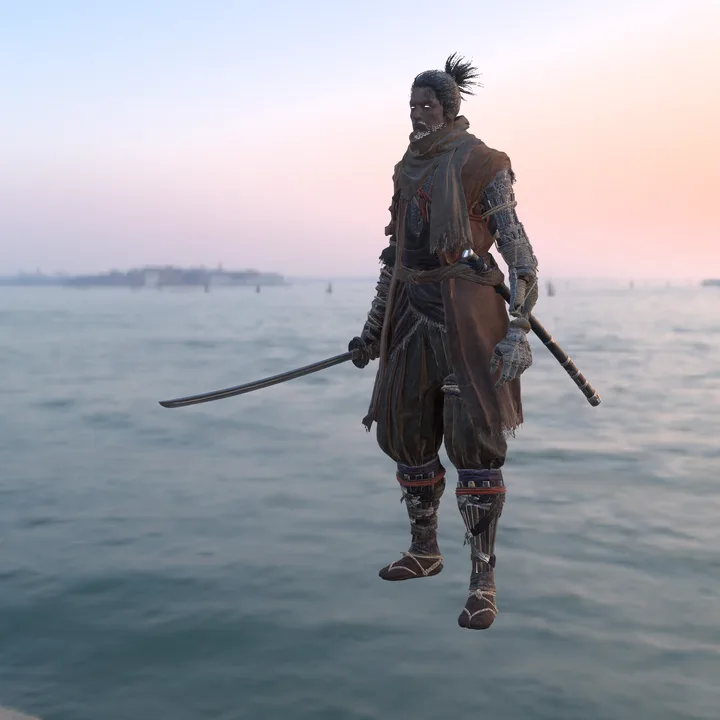

# Related work

The layouts follow the community's documentation of these formats, chiefly SoulsFormats and SoulsFormatsNEXT (names of unknown fields follow them), Paramdex and Smithbox (param layouts), the fxr project (the names, types and defaults of the effect actions' parameters; Unlicense), and UXM (archive lists and path hashes); the tests check this crate's readings against theirs.

The crate is used by [primase](https://github.com/Kalmarv/primase), a game-asset conversion library.

Sekiro's Wolf with the Kusabimaru in a slash combo (`a050_300000`). fromsoft-formats reads the game's files for it: the archives, DCX envelopes and BND4 binders, the FLVER models of his four outfit parts and of the sword, their TPF textures and MTD materials, and the animation's TAE events. [havok-formats](https://github.com/Kalmarv/havok-formats) reads the skeleton and the animation, [havok-cloth](https://github.com/Kalmarv/havok-cloth) steps the cloth of his outfit, and the frames are drawn with the game's own shader programs, lit by Poly Haven's Venice Sunset HDRI.
